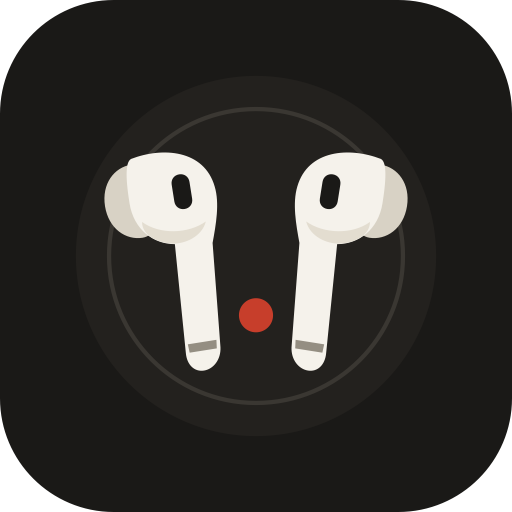

<p align="center">
  
</p>

<h1 align="center">SumiPods (墨ポッズ)</h1>

A minimalist Android companion app for checking **Apple AirPods Pro 3 / Pro 2** battery levels, crafted with Japanese **MUJI × Ma (間) Washi** aesthetics, **Sumi-e ink brush** battery bars, **Zen Maru Gothic** typography, and a **Kamon Blueprint** hardware stage.

## Features

- **Real-time AirPods Pro 3 & Pro 2 BLE Decoding**: Parses Apple Continuity Proximity Pairing (`0x004C` / `0x07`) advertisements for Left, Right, and MagSafe Case battery percentages (10% steps), charging flags, in-ear detection, and case lid state.
- **Sumi-e Ink Battery Bars**: Custom Jetpack Compose `Canvas` 10-step bars rendered as organic sumi ink strokes with soft *nijimi* (滲み) bleed, *kasure* (掠れ) dry-brush texture, ochre charging shimmer, and Shu-iro vermilion ink at ≤ 20%.
- **Connected AirPods Only (Zero False Positives)**: Strictly gates BLE scanning, notifications, and popups on your own paired AirPods being actively connected via Bluetooth (`ACTION_ACL_CONNECTED` / A2DP / HFP), eliminating nearby strangers' AirPods popups and yielding 0% idle BLE battery drain when disconnected.
- **Floating Auto-Popup**: Slides up a translucent MUJI Washi sheet over any app when your paired AirPods connect or open their case (and stays suppressed when SumiPods is already open).
- **Bilingual Japanese Micro-Labels**: Optional subtle Kanji/Katakana markers (`左 / 右 / 充電ケース`), toggleable in Settings.

## Tech Stack

- **Kotlin** + **Jetpack Compose** (Material 3)
- **Android BLE** (`BluetoothLeScanner`, `WindowManager` `TYPE_APPLICATION_OVERLAY`, Foreground Service)
- **Bundled Font**: Zen Maru Gothic (SIL Open Font License)

## Building & Installing

Open `SumiPods` in Android Studio, or build from the command line:

```bash
./gradlew testDebugUnitTest assembleDebug
adb install -r app/build/outputs/apk/debug/app-debug.apk
```
